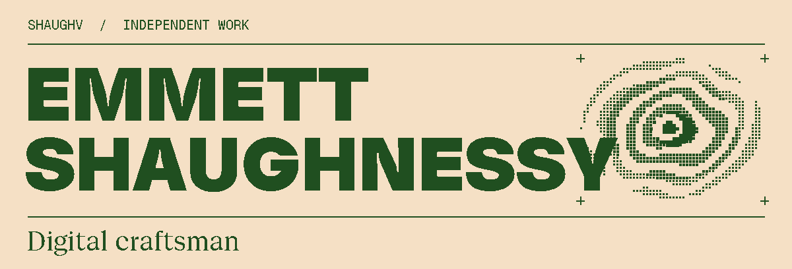
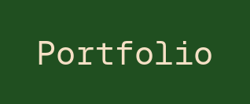
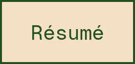
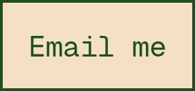
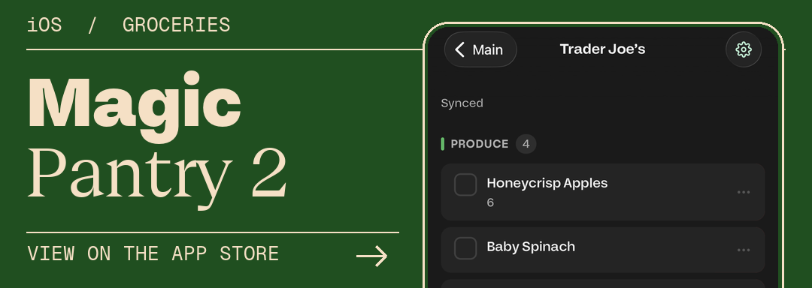
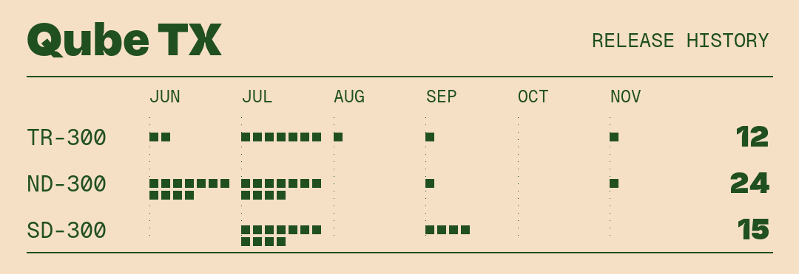
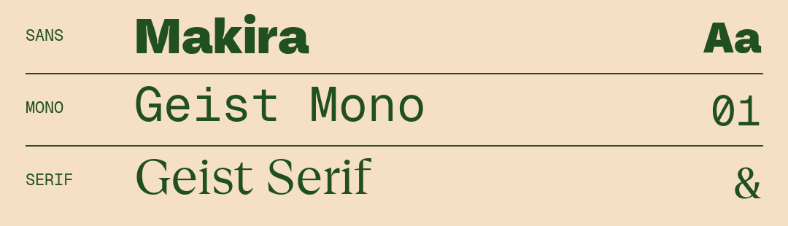

<picture>
  <source media="(prefers-color-scheme: dark)" srcset="./assets/masthead-dark.png">
  
</picture>

I build things I use myself, from a grocery list that works offline to Rust tools that tell me why a machine dropped off the network.

<a href="https://emmettshaughnessy.com"><picture><source media="(prefers-color-scheme: dark)" srcset="./assets/portfolio-dark.png"></picture></a>
<a href="https://resume.emmetts.dev"><picture><source media="(prefers-color-scheme: dark)" srcset="./assets/resume-dark.png"></picture></a>
<a href="mailto:hey@emmetts.dev"><picture><source media="(prefers-color-scheme: dark)" srcset="./assets/email-dark.png"></picture></a>

On this page

[Apps you can use](#apps-you-can-use) · [Developer tools](#developer-tools) · [Type and design resources](#type-and-design-resources)

## Apps you can use

**Magic Pantry 2** keeps a shared grocery list for each store and sorts it by aisle. You can check off the apples in a dead zone and the change will sync when you get reception again. [Get Magic Pantry 2](https://apps.apple.com/us/app/magic-pantry-2/id6757911019)

**Tikset** is a clock for setting your watch. It checks your computer against network time and shows how far ahead or behind it’s running. [Check your clock](https://tikset.com/)

## Developer tools

<a href="https://www.qubetx.com/#products">
  <picture>
    <source media="(prefers-color-scheme: dark)" srcset="./assets/releases-dark.png">
    
  </picture>
</a>

**Qube TX** is where I publish my Rust diagnostics. Each square above is a public release from June 1 through November 20, 2026.

- [TR-300 · Machine Report](https://github.com/QubeTX/qube-machine-report) inventories the hardware and OS on the machine in front of you.
- [ND-300 · Network Diagnostics](https://github.com/QubeTX/qube-network-diagnostics) helps track down where a connection is failing.
- [SD-300 · System Diagnostics](https://github.com/QubeTX/qube-system-diagnostics) checks system health from the terminal or desktop.

**shaughv-code** collects the skills I use with Codex and Claude Code for debugging, handoffs, and release notes. I built **shaughv-tasks** alongside it so the next session can pick up where I left off. [Browse the skills](https://github.com/RealEmmettS/shaughv-code) · [Open the task board repo](https://github.com/RealEmmettS/shaughv-tasks)

**Occupancy Forecast** is a Home Assistant add-on I maintain as a fork. It predicts who’ll be home over the next 48 hours. Its local journal lets me compare a prediction with who actually showed up. [Explore the add-on](https://github.com/RealEmmettS/hass-occupancy)

## Type and design resources

<a href="https://cdn.shaughv.com/fonts">
  <picture>
    <source media="(prefers-color-scheme: dark)" srcset="./assets/type-dark.png">
    
  </picture>
</a>

I keep the type, marks, and web components I use across my sites on the **SHAUGHV CDN**. You can see all three typefaces in the masthead. My name is set in Makira, the small label in Geist Mono, and “Digital craftsman” in Geist Serif.

[Browse the CDN](https://cdn.shaughv.com/) · [Open the asset catalog (JSON)](https://cdn.shaughv.com/tree.json) · [See all my repositories](https://github.com/RealEmmettS?tab=repositories)

Honk?

I also wrote a desktop goose in Rust. It walks across monitors, honks, and leaves muddy footprints. [Let the goose loose](https://github.com/RealEmmettS/goose)

